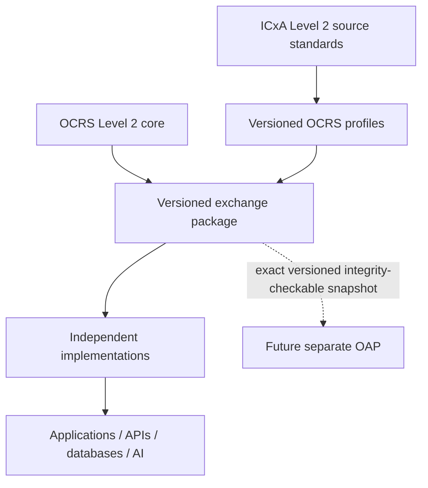

# OCRS architecture guide

OCRS separates protocol content from implementations. The normative draft consists of specification chapters, modular schemas, profile declarations, and conformance behavior. The TypeScript code is an optional deterministic reference implementation.

AI may query or summarize OCRS but is never required. The truth model is versioned records plus deterministic rules. The optional future arrow is one-way compatibility, not an OCRS dependency or OAP transaction design.

## Validation layers

1. Draft 2020-12 meta-schema and schema compilation.
2. Package structure and profile-definition validation.
3. Semantic identifier, typed-reference, inventory, evidence usability/scope, gate/review/decision context, Level 2 authority, history, boundary, Deficiency, dependency, handover/TOC, extension, and integrity rules.
4. Profile evaluation (RFDC only in v0.1).
5. Human Level 2 Review, Recommendation, or readiness decision, represented only when explicitly recorded.

## Required design review

| Question from the original brief                          | v0.1 answer                                                                                                                      |
| --------------------------------------------------------- | -------------------------------------------------------------------------------------------------------------------------------- |
| Why not ready / missing vs failed evidence?               | Yes. Condition/evidence explanation nodes preserve `indeterminate` vs `not_satisfied`.                                           |
| Deficiency vs constraint / dependencies?                  | Yes. Separate schemas and rules.                                                                                                 |
| Deterministic evaluation vs Level 2 decision?             | Yes. The evaluator creates no human record.                                                                                      |
| Level 1 evaluation/authorization distinction?             | Superseded: those records are outside OCRS under ADR-0002; all OCRS outputs explicitly stop at Level 2.                          |
| Provenance and superseded evidence?                       | Yes. Evidence, Provenance, Revision, supersession, inventory, and change records are separate.                                   |
| Lossless independent exchange?                            | Yes for declared v0.1 records/profiles; Exchange Conformance requires preservation.                                              |
| Work without AI / allow AI interrogation?                 | Yes / yes. AI has no normative role.                                                                                             |
| Project extensions without core edits?                    | Yes, through declared qualified namespaces.                                                                                      |
| Future v0.2 compatibility?                                | Yes, through independent semantic core/schema/profile versions; breaking change still requires migration.                        |
| Independent commercial implementation?                    | Yes, subject to final published licenses; no proprietary ICxA software is required.                                              |
| ICxA stewardship?                                         | Proposed for official specification, namespaces, profiles, releases, and conformance suites; formal appointment remains open.    |
| Former Outcome Obligation/Requirement/OEN distinctions?   | Not applicable to OCRS v0.1; OAP is deferred and not modeled.                                                                    |
| Commissioning vs Operational Readiness gates?             | Yes. Separate schemas and controlled types. External outcome gates are outside OCRS.                                             |
| Evaluation vs Recommendation vs external authorization?   | Yes. Evaluation and Recommendation are separate; external authorization is outside OCRS.                                         |
| Preserve system/interface conflicts?                      | Yes. `PROJECT_STATUS_OVERRIDE` rejects a conflicting ready aggregate.                                                            |
| Category A/B/C/D and reclassification?                    | Yes. Separate category, risk, effect, closure, acceptance, plan, and history fields.                                             |
| System Handover vs Transfer of Operational Control?       | Yes. Separate boundary and record types; control requires an explicit record.                                                    |
| OR lifecycle, pillars, ORC/AOCR/IOC/FOC without redesign? | Yes at core representability level; detailed profiles are deferred.                                                              |
| Former non-authorization history question?                | External authorization is outside OCRS; Level 2 readiness decision corrections and supersession are preserved without overwrite. |
