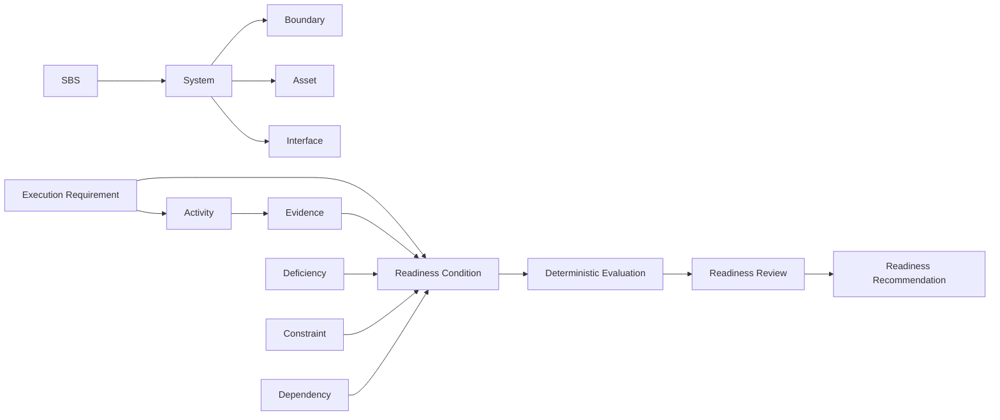

# Ontology

The normalized core entities are Project; SBS; System; Hierarchical System Relationship; Asset; Interface; Boundary; Party; Level 2 Role Assignment; Authority Scope; Execution Requirement; Readiness Condition; Activity; Evidence; Evidence Provenance; Evidence Revision; Deficiency; Deficiency Reclassification; Constraint; Dependency; Residual-risk Input; Deterministic Evaluation; Evaluation Explanation; Commissioning Stage-Gate; Operational Readiness Gate; Readiness Review; Readiness Recommendation; Readiness Decision; System Handover; Transfer of Operational Control; Condition; Change Record; Profile Declaration; Extension Declaration; and Package Manifest.

All records carry a stable namespaced identifier, entity type, semantic record version, and unambiguous timestamp. References are normalized identifiers rather than nested copies.
